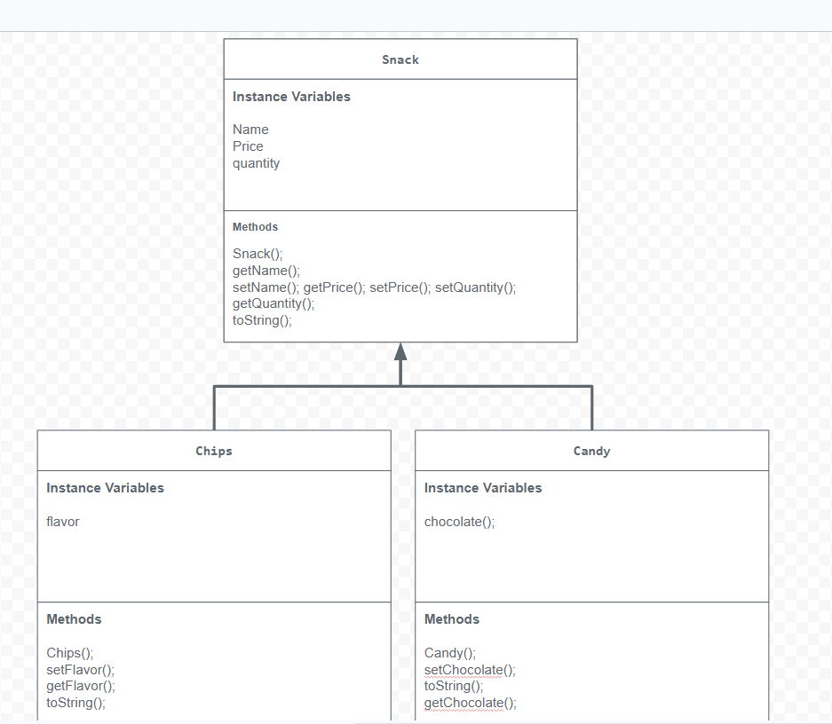

# Unit 2 - Store Management Project

## Introduction

You are opening a new business in your community! Businesses often need programs to manage the products and services they offer and track orders and requests from customers. Your goal is to create a store management system for your business.

## Requirements

Use your knowledge of object-oriented programming and class structure and design to create your store management system:
- **Create a class hierarchy** – Develop a superclass that represents a product or service your business offers and one or more subclasses that extend the superclass to represent more specific types of products or services.
- **Declare instance variables** – Declare instance variables in the superclass that are shared with the subclasses and instance variables in the subclasses that are not shared with the superclass.
- **Write constructors** – Write no-argument and parameterized constructors in the superclass and subclasses. Subclass constructors use the super keyword to call the superclass constructor.
- **Implement accessor and mutator methods** – Write accessor and mutator methods for instance variables that should be accessible and/or modifiable from outside of the class.
- **Implement a toString() method** – Write toString() methods in the superclass and subclasses that return information about the state of an object.

## UML Diagram

Embed your UML Diagram here. Upload the image of your UML Diagram to your repo, then use Markdown to insert your image here:

## Description

1. Write a description of your project here. Include what your store you made, and why you chose this topic. In your description, include as many vocab words from our class to explain how you represented the item/service from your store. If you have user input, explain how the user will interact with your store such as which questions are prompted to the user, what response is your program expecting, and how that is used to output information for your store in the console.

2. How is this project related to STEAM (Science, Technology, Engineering, Art, and Mathematics)? Provide explicit examples from the project and details as possible. 

3. What SLOs did you demonstrate during completing this project?

1, In my project, I created a store that sells snacks. I chose this topic because it was my favorite out of the ones Mr.Aiello provided for us. I used object oriented coding in order to create my code. I made the Snack class the superclass and the chips, candy, and drink class are all subclasses. I created private instance variables for the snack class while creating separate instance variables for the subclasses. The constructors I made included the no argument and paramaterized constructor. I used the super code to let the subclasses call the superclass constructors and used accessor and mutator methods for the get and set instance varaibles. The classes all have a toString method in order to return the information the snack gets and in the storerunner class the objects print their own info to the console. 

2 This project is related to STEAM because I used coding to display technology using different codes to display information about snacks in my store. I displayed engineering when designing my different classes such as my super and subclass. I used mathematics when displaying the prices and quantities for my snacks in the code. Art is displayed when designing my code and displaying the code in my console. 

3 I showed problem solving, creativity, and critical thinking in my project. First, I used problem solving when trying to code and debug my code. I used my creativity skills in order to demonstrate how to code different snacks and implement inheritance and coding into my store project. I demonstrated critical thinking when choosing the specific instance variables and which methods the classes needed. 